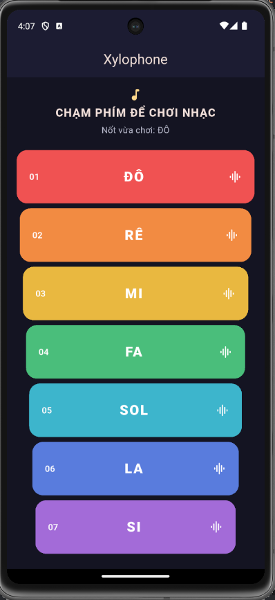

# Flutter Lab 05 — Xylophone

Ứng dụng đàn Xylophone gồm bảy phím màu Đô–Si. Chạm vào một phím để nghe nốt tương ứng và xem tên nốt vừa chơi.

## Ảnh ứng dụng



## Nội dung thực hành

- Giao diện Material Design với `MaterialApp`, `Scaffold`, `Column`, `Expanded` và `TextButton`.
- Bảy tệp WAV trong `assets/notes/`, khai báo ở `pubspec.yaml`.
- Dùng package `audioplayers` để phát âm thanh của từng phím.
- Phím có hiệu ứng bấm và phần hiển thị nốt nhạc đang chọn.

## Chạy và kiểm tra

```bash
flutter pub get
flutter run
flutter analyze
flutter test
```

Chọn thiết bị Android hoặc trình giả lập trước khi chạy. Có thể tạo lại bảy âm thanh gốc bằng `python tools/generate_notes.py`; script chỉ dùng thư viện chuẩn Python.
